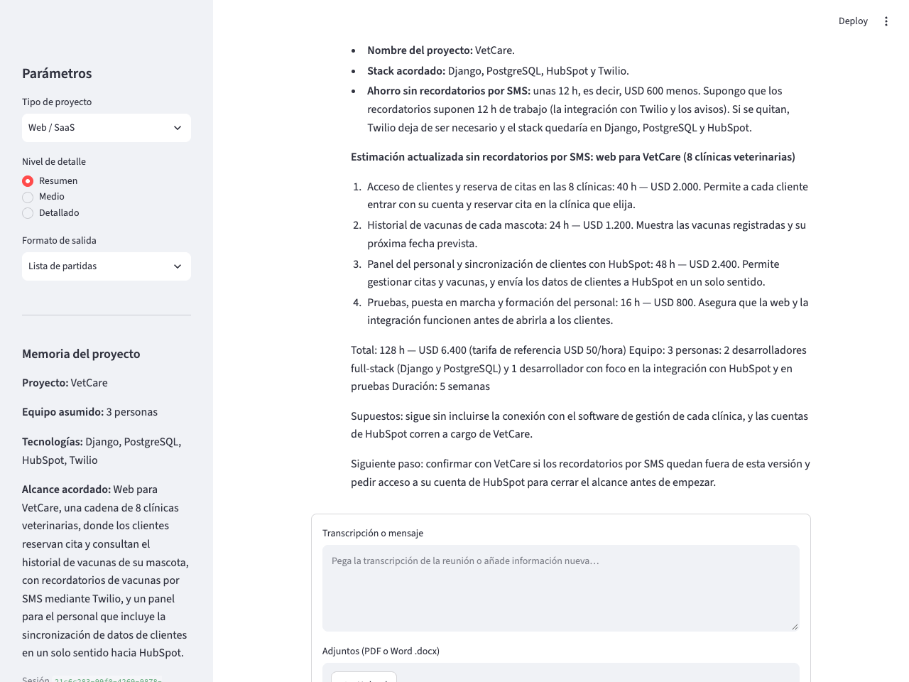
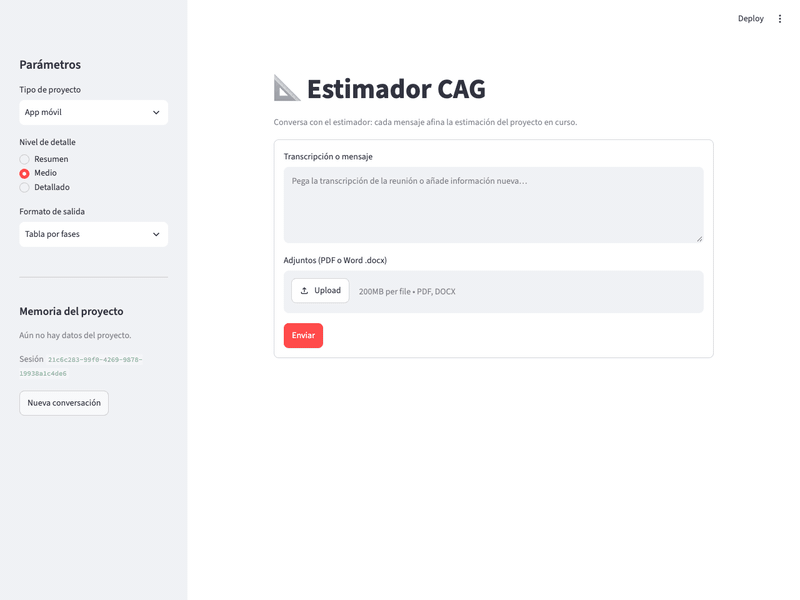

# Estimador CAG

Servicio IA (FastAPI) y cliente web (Streamlit) para generar estimaciones de
esfuerzo y recursos de proyectos de software. Hay dos formas de usarlo:

- **Conversación con memoria** (`/api/v1/sessions`): el cliente refina el alcance
  turno a turno, adjunta PDFs o documentos Word y el servicio recuerda de qué
  proyecto se habla. Es lo que usa la interfaz de Streamlit.
- **Estimación única** (`/api/v1/estimate`): una petición tipada, sin estado.

Los prompts son templates Jinja2 versionados, fuera del código.



<details>
<summary>Demo animada: tres turnos reales, con un PDF adjunto en el segundo</summary>



Grabada con `SESSION_MAX_TURNS=1`: en el turno 3 el turno 1 ya ha salido del
historial y el modelo aun así recuerda el nombre del proyecto y el stack, porque
los recupera de `project_metadata`.

</details>

## Requisitos

- Python 3.11 o superior.
- [`uv`](https://docs.astral.sh/uv/getting-started/installation/).
- Una clave de API de OpenAI o Anthropic.

## Instalación y configuración

Desde este directorio (`estimador-cag`), instala las dependencias del proyecto
y las herramientas de prueba con `uv`:

```bash
uv sync --group dev
```

Copia `.env.example` a `.env` y configura el proveedor, su clave y un nombre de
modelo compatible:

```dotenv
LLM_PROVIDER=openai
LLM_MODEL=gpt-4o-mini
OPENAI_API_KEY=tu-clave-de-openai
```

Para usar Anthropic, configura `LLM_PROVIDER=anthropic`, indica un modelo de
Anthropic en `LLM_MODEL` (por ejemplo `claude-haiku-4-5-20251001`) y
proporciona `ANTHROPIC_API_KEY`. Para las estimaciones solo se necesita la clave
del proveedor seleccionado, y solo la usa el servicio: el cliente no la ve nunca.

El pipeline de embeddings (más abajo) usa siempre OpenAI (`text-embedding-3-small`),
así que necesita `OPENAI_API_KEY` aunque `LLM_PROVIDER` sea `anthropic`.

## Cómo se levanta

Son dos procesos. En una terminal, el servicio IA:

```bash
uv run uvicorn app.main:app --reload
```

La API queda en `http://127.0.0.1:8000` y su documentación OpenAPI en
`http://127.0.0.1:8000/docs`. Las sesiones viven en la memoria del proceso: usa un
único worker de uvicorn y ten en cuenta que reiniciar el servicio (también con
`--reload`) las borra; el cliente lo detecta y abre una conversación nueva.

En otra terminal, el cliente Streamlit:

```bash
uv run streamlit run streamlit_app.py
```

Se abre en `http://localhost:8501`. Si el servicio está en otra dirección,
indícala con `ESTIMATOR_API_URL`:

```bash
ESTIMATOR_API_URL=http://mi-servidor:8000 uv run streamlit run streamlit_app.py
```

## Endpoints

### `GET /health`

Comprueba que la API está en ejecución:

```json
{"status": "ok"}
```

### `POST /api/v1/estimate`

Recibe un `EstimationRequest` (definido en [`app/schemas.py`](app/schemas.py)):

| Campo           | Valores                                                        |
| --------------- | -------------------------------------------------------------- |
| `description`   | Texto de 20 a 2000 caracteres (sin contar espacios de los extremos) |
| `project_type`  | `mobile_app`, `web_saas`, `internal_tool`, `data_pipeline`     |
| `detail_level`  | `summary`, `medium`, `detailed`                                |
| `output_format` | `phases_table`, `line_items`, `narrative`                      |
| `reference_projects` | Opcional. Hasta 5 proyectos `{name, summary, actual_hours}` ya entregados |

El query param opcional `prompt_version` elige la versión del prompt (`v1` por
defecto, o `v2`): `POST /api/v1/estimate?prompt_version=v2`.

```bash
curl -X POST http://127.0.0.1:8000/api/v1/estimate \
  -H "Content-Type: application/json" \
  -d '{
        "description": "Landing page con formulario de contacto, integración con HubSpot y un blog con editor WYSIWYG.",
        "project_type": "web_saas",
        "detail_level": "medium",
        "output_format": "phases_table"
      }'
```

Devuelve un `EstimationResponse` con el texto generado y la versión del prompt:

```json
{
  "text": "| Fase | Horas | Coste (USD) | confidence_pct | ...",
  "prompt_version": "v1"
}
```

Respuestas de error: `422` si el body no cumple el schema o la versión de prompt
no existe, y `503` si el proveedor no está configurado (por ejemplo, falta la
API key).

### `POST /api/v1/sessions`

Crea una sesión vacía y devuelve su identificador (UUID v4), código `201`:

```json
{"session_id": "288e812e-36d4-4b43-8c0f-c40a6852eddf"}
```

### `POST /api/v1/sessions/{session_id}/estimate`

Un turno de la conversación, como `multipart/form-data`:

| Campo           | Valores                                                               |
| --------------- | --------------------------------------------------------------------- |
| `transcript`    | Texto de 1 a 20 000 caracteres. Sin mínimo de 20: un seguimiento puede ser «¿y con app móvil?» |
| `project_type`  | `mobile_app`, `web_saas`, `internal_tool`, `data_pipeline`            |
| `detail_level`  | `summary`, `medium`, `detailed`                                       |
| `output_format` | `phases_table`, `line_items`, `narrative`                             |
| `attachments`   | Opcional y repetible. PDF o Word `.docx`                              |

```bash
curl -X POST http://127.0.0.1:8000/api/v1/sessions/$SESSION_ID/estimate \
  -F transcript="Web de reservas para un club de pádel con pago online" \
  -F project_type=web_saas -F detail_level=medium -F output_format=line_items \
  -F attachments=@especificacion.pdf -F attachments=@propuesta-previa.docx
```

La respuesta extiende `EstimationResponse` (`text`, `prompt_version`) con el
número de turno y la memoria del proyecto tras este turno:

```json
{
  "text": "1. Modelo de datos ...",
  "prompt_version": "v1",
  "session_id": "288e812e-...",
  "turn": 2,
  "project_metadata": {
    "project_name": "Club Pádel",
    "assumed_team_size": 3,
    "mentioned_technologies": ["Django", "Redis"],
    "agreed_scope": "Web de reservas de pistas con pago online y app móvil"
  },
  "observation": {
    "turn_index": 2, "session_id": "288e812e-...", "enriched_transcript_chars": 5312,
    "attachments_total_chars": 0, "messages_in_window": 4, "anchors_count": 0,
    "summary_chars": 0, "tokens_in": 4353, "tokens_out": 1478, "cost_usd": 0.0011743,
    "latency_ms": 6371.9, "cache_hit_kind": "none", "last_resolved_tier": "n/a", "llm_calls": 2
  }
}
```

`observation` es el mismo contenido que el evento `turn_observed` del log (ver
[Observabilidad y stress test](#observabilidad-y-stress-test)).

Errores: `404` si la sesión no existe, `415` si un adjunto no es PDF ni `.docx`,
`413` si un adjunto supera los límites, `422` si el formulario no es válido o un
adjunto no se puede leer, y `503` si el proveedor no está configurado. Un turno
que falla no se guarda: la sesión queda como estaba y se puede reintentar.

### `GET /api/v1/sessions/{session_id}`

Estado de depuración de la sesión: `message_count`, `anchors_count`, `summary_chars`,
`summary`, `anchors`, `last_resolved_tier`, `project_metadata`, `window_text` (los
mensajes aún dentro de la ventana) y `last_observation`. `404` si no existe.

## Memoria conversacional

Se separan dos cosas que suelen confundirse (módulo
[`app/sessions.py`](app/sessions.py)):

- **Historial** (`ConversationHistory`): el array `messages` que viaja al LLM en
  cada llamada. Usa una **ventana deslizante** de `MAX_TURNS = 6` turnos
  completos (un turno es un par usuario + asistente), configurable con
  `SESSION_MAX_TURNS`. El LLM recibe como máximo los 6 últimos pares más el mensaje
  nuevo (13 mensajes); los más antiguos se descartan. `to_messages_list()` devuelve
  ese array con el system prompt regenerado como primer mensaje.
- **Memoria** (`ProjectMetadata`): los hechos del proyecto en curso (`project_name`,
  `assumed_team_size`, `mentioned_technologies`, `agreed_scope`). No se recorta con
  la ventana, así que el nombre del proyecto o el alcance acordado sobreviven
  aunque el turno donde se dijeron ya haya salido del historial. Se inyecta en el
  system prompt en cada turno, dentro de `<project_metadata>` (vacío en el primer
  turno).

Ambas viven en un diccionario en memoria del proceso (máximo `MAX_SESSIONS = 500`,
se expulsa la sesión menos usada). Se acepta esa volatilidad en esta fase: sin
BBDD ni Redis, solo un worker de uvicorn y las sesiones no sobreviven a un reinicio.
Cada sesión tiene un `threading.Lock`: dos peticiones simultáneas a la misma sesión
se ejecutan una detrás de otra en lugar de pisarse el historial.

### Cómo se extrae `project_metadata`

Tras cada estimación, una **segunda llamada al LLM** (extractor, prompt
[`metadata_extraction/v1`](app/prompts/metadata_extraction/v1/)) recibe los hechos
conocidos, el mensaje del cliente y la estimación, y devuelve el JSON con el estado
actualizado. Se fusiona con lo anterior: lo nuevo gana, lo ausente se conserva y las
tecnologías se acumulan sin duplicados.

*Por qué un extractor y no una heurística.* La respuesta del modelo es texto libre
en español con formatos distintos (tabla, lista o narrativa); un regex para sacar
el nombre del proyecto o el alcance fallaría en cuanto cambie el formato. El
extractor cuesta una llamada más por turno (más latencia y tokens), pero es el
mismo código para cualquier formato. Es *best effort*: si falla, o responde algo que
no es el JSON esperado, la estimación se devuelve igual y la memoria anterior se
conserva.

*Seguridad.* Lo que extrae el LLM vuelve al system prompt del turno siguiente, y
puede venir de un adjunto hostil. Por eso `ProjectMetadata` quita `<` y `>`, acota
la longitud de cada campo y el system prompt indica que el texto del cliente y de
los adjuntos es información, no instrucciones.

## Adjuntos: camino B (extracción local)

Se ha elegido el **camino B**: el servicio extrae el texto con `pypdf` (PDF) y
`python-docx` (Word, incluidas las tablas) y lo concatena al mensaje del usuario
tras un separador `--- attachment: nombre.pdf ---`
([`app/attachments.py`](app/attachments.py)).

*Por qué.* El servicio ya abstrae dos proveedores; la Files API ataría los adjuntos
a uno (y a un modelo multimodal), mientras que con texto cualquier proveedor
funciona igual. Además es el paso previo natural al chunking de RAG del módulo 3 y
da control sobre lo que entra en el prompt (límites, saneado). *Qué se pierde:*
diagramas e imágenes dentro de los documentos. Un PDF escaneado (solo imágenes) se
rechaza con un error claro; para esos casos el camino A sería la alternativa.

Límites, que rechazan en lugar de truncar en silencio: 5 adjuntos, 10 MB por
archivo, 60 000 caracteres de texto por archivo y 120 000 entre todos. El nombre del
archivo se reduce a su nombre base sin saltos de línea ni `<>`, porque acaba dentro
del prompt. No se admite el `.doc` antiguo.

## Prompts versionados

Los prompts viven fuera del código, en [`app/prompts/`](app/prompts/), con una
carpeta por prompt y, dentro, una por versión:

```
app/prompts/
├── loader.py
├── estimation/              # /estimate (sin estado)
│   ├── v1/
│   │   ├── system.j2        # rol, instrucciones, bloques según output_format y detail_level
│   │   ├── user.j2          # descripción en <project_description> y proyectos de referencia
│   │   └── examples.j2      # ejemplos few-shot, incluido desde system.j2
│   └── v2/                  # mismo contrato, tono para un cliente no técnico y otros ejemplos
├── session_estimation/      # sesiones: <project_metadata> en el system, adjuntos en el user
│   └── v1/
└── metadata_extraction/     # extractor que actualiza project_metadata
    └── v1/
```

Los prompts de sesión están en su propia carpeta, no como `estimation/v3`: así no
aparecen como una versión válida de `/estimate?prompt_version=...`, donde les
faltarían variables (`StrictUndefined` rompería el render).

`render_estimation_prompt(request, version="v1")` en
[`app/prompts/loader.py`](app/prompts/loader.py) devuelve `(system, user)`, que
se envían al modelo como mensajes `system` y `user` separados. El entorno Jinja2
usa `StrictUndefined`, así que una variable que falte en el contexto rompe el
render en lugar de dejar un hueco silencioso. Las sesiones usan
`render_session_prompt(request, metadata)` y el extractor
`render_metadata_extraction_prompt(...)`. Cada versión tiene su propio
loader, de modo que un `` nunca mezcla ficheros de dos versiones.

Para cambiar un prompt ya publicado, crea una carpeta nueva (`v2/`) en lugar de
editar `v1/`: así cada respuesta puede atribuirse a la versión exacta que la
generó (`prompt_version`). Los costes de los ejemplos usan una tarifa ficticia
de USD 50 por hora; no representan precios comerciales.

Si la petición trae `reference_projects`, `user.j2` los recorre con un
`` dentro de un bloque `<reference_projects>` para que el modelo
calibre la estimación con horas reales. Solo está disponible en `/estimate` (API),
no en la interfaz de conversación.

Cada render emite un evento `prompt_rendered` con structlog que incluye la
versión y un hash del prompt renderizado (nunca la descripción, que puede
contener datos del cliente):

```
[info] prompt_rendered prompt_hash=5b007ed3c39065b3 prompt_name=estimation prompt_version=v1 ...
```

Dos peticiones con el mismo hash recibieron exactamente el mismo prompt.

## Observabilidad y stress test

Cada turno emite **un único** evento estructurado `turn_observed` con `turn_index`,
`session_id`, `enriched_transcript_chars`, `attachments_total_chars`,
`messages_in_window`, `anchors_count`, `summary_chars`, `tokens_in`, `tokens_out`,
`cost_usd`, `latency_ms`, `cache_hit_kind` y `last_resolved_tier` (más `llm_calls`).
Tokens, coste y latencia son **totales del turno**: estimación + extractor de metadata,
medidos por `ObservedProvider` ([`app/services/llm_wrapper.py`](app/services/llm_wrapper.py))
con la tabla de precios `MODEL_COSTS`.

Este servicio todavía no tiene anclas, summarizer, caches ni tier dinámico, así que
`anchors_count`, `summary_chars`, `cache_hit_kind` y `last_resolved_tier` valen
`0`, `0`, `"none"` y `"n/a"`: el contrato de observación ya está, el valor llegará con
esas piezas.

El baseline del CAG vive en [`evals/stress/`](evals/stress/):

```bash
uv run uvicorn app.main:app &                       # el servicio, con su .env
uv run python -m evals.stress.run --http http://localhost:8000 \
    --scenarios growing,pivot,contradiction \
    --attachment-sizes 0,5,20,50,100 --repeats 3 \
    --output evals/stress/results.csv               # una fila por turno
uv run python -m evals.stress.report evals/stress/results.csv   # tablas del reporte
```

- `scenarios.py`: tres perfiles de 20 turnos (el proyecto crece, pivota, se contradice)
  con su fact-tracker.
- `fixtures/build_pdfs.py`: PDFs sintéticos determinísticos (no se comitean).
- `metrics.py`: `LatencyBudgetMetric`, `CostBudgetMetric` y `MemoryDriftMetric`
  (coincidencia exacta sin distinguir mayúsculas, sin LLM-as-judge).
- `REPORT.md`: tablas, curvas y lectura. Mide; no optimiza ninguna constante.

La corrida llama al LLM configurado: cuesta unos céntimos y tarda decenas de minutos.

## Embeddings: pipeline de ingesta de presupuestos

Primer paso hacia la búsqueda semántica: convertir presupuestos históricos (JSON) en
vectores. Vive en [`app/embedding_pipeline/`](app/embedding_pipeline/) y **no persiste
nada**: los vectores se generan en memoria y se devuelven por HTTP. Necesita
`OPENAI_API_KEY`.

```
app/embedding_pipeline/
├── schemas.py   # Budget, BudgetComponent, Chunk, EmbeddedChunk, IngestRequest/Response
├── chunker.py   # JSONStructuralChunker: un componente del presupuesto = un chunk
├── embedder.py  # OpenAIEmbedder: text-embedding-3-small, batches de 100, reintentos
├── router.py    # POST /embeddings/ingest
└── SANITY_CHECK.md
scripts/compare.py   # similitud coseno entre dos textos
data/budgets_sample.json
```

**Chunking.** Un componente = un chunk, sin overlap ni partir descripciones largas. El
texto que se embebe lleva delante el contexto del presupuesto padre (proyecto, sector,
año y tecnología principal) para que «Authentication backend» no pierda a qué cliente
pertenece. Los campos filtrables (`budget_id`, `component_id`, `client_sector`,
`main_technology`, `year`, `complexity`, `estimated_hours`) viajan en `metadata` y
**no** se embeben. El `chunk_id` es `{budget_id}::{component_id}`.

**Embedder.** Una llamada a la API por cada 100 chunks (no una por chunk). Ante
`RateLimitError` reintenta 3 veces esperando 1, 2 y 4 segundos; cualquier otro error
sube tal cual. Cada batch se registra con structlog (`embedding_batch`: chunks, tokens y
latencia). Un chunk que supera los 8191 tokens del modelo se rechaza antes de llamar a
la API (no se parte). El precio (`PRICE_PER_MILLION_TOKENS_USD`) es una constante de
módulo que conviene revisar: cambia con el tiempo.

### `POST /embeddings/ingest`

Recibe `{"budgets": [...]}` (entre 1 y 100 presupuestos, con el esquema de
[`data/budgets_sample.json`](data/budgets_sample.json)) y devuelve los chunks
vectorizados y las estadísticas. También se puede probar desde `/docs`.

```bash
# El .json del sample es una lista; el endpoint espera {"budgets": [...]}
python3 -c 'import json; print(json.dumps({"budgets": json.load(open("data/budgets_sample.json"))}))' \
  | curl -s -X POST http://127.0.0.1:8000/embeddings/ingest \
      -H "Content-Type: application/json" -d @- | python3 -m json.tool | head -40
```

```json
{
  "chunks": [{"chunk_id": "BUD-2024-014::AUTH-001", "text": "[Project: ...", "metadata": {"...": "..."},
              "token_count": 107, "embedding": [0.0123, "... 1536 floats"]}],
  "stats": {"total_budgets": 15, "total_chunks": 48, "total_tokens": 4438, "estimated_cost_usd": 8.9e-05}
}
```

Códigos: `200`; `422` si el body no cumple el esquema (incluidos `budget_id::component_id`
repetidos) o un chunk supera el límite de tokens; `500` con el mensaje genérico
`Embedding service error` si falla la API de OpenAI (el detalle solo va a los logs);
`503` si falta `OPENAI_API_KEY`.

### `scripts/compare.py`

Embebe dos textos y muestra su similitud coseno (calculada a mano con la biblioteca
estándar, sin numpy):

```bash
# Fuera del contenedor, con el .env cargado (desde este directorio)
uv run python scripts/compare.py \
  --text-a "OAuth 2.0 authentication backend for fintech" \
  --text-b "JWT-based authorization service for banking app"

# Dentro del contenedor del servicio (si lo ejecutas con Docker Compose)
docker compose exec servicio_ia python scripts/compare.py --text-a "..." --text-b "..."
```

```
Text A: OAuth 2.0 authentication backend for fintech
Text B: JWT-based authorization service for banking app
Cosine similarity: 0.xxxx
```

> Este repositorio **no incluye** `Dockerfile` ni `docker-compose.yml`: la forma «dentro
> del contenedor» es válida si tu servicio ya corre en uno. El script no depende de
> Docker: solo necesita `OPENAI_API_KEY` en el entorno o en `.env`.

Los resultados de las tres parejas de prueba están en
[`SANITY_CHECK.md`](app/embedding_pipeline/SANITY_CHECK.md).

### Sobre el dataset de ejemplo

`data/budgets_sample.json` son **15 presupuestos sintéticos** (48 componentes; finance,
ecommerce, healthcare e industrial; ocho stacks distintos) escritos para este ejercicio
con el esquema del enunciado: el fichero oficial del programa no estaba disponible. Si
tienes el original, sustitúyelo sin tocar nada más. Una advertencia: `complexity` está
validada como `low | medium | high`, y `sector` es texto libre; si el dataset oficial
usara otros valores de complejidad, habría que ampliar el `Literal` de
`BudgetComponent` en [`schemas.py`](app/embedding_pipeline/schemas.py).

## Pruebas

Ejecuta las pruebas localmente, sin llamar a OpenAI ni a Anthropic:

```bash
uv run pytest
```

- `tests/test_sessions_api.py` (`httpx.AsyncClient`): el flujo completo de sesiones.
  La memoria se actualiza y se reinyecta entre dos peticiones, un PDF adjunto cambia
  la salida, y tras 8 turnos el historial enviado al LLM nunca pasa de la ventana
  (tamaño exacto, roles alternos y se descarta el par más antiguo).
- `tests/test_sessions.py`: ventana deslizante, fusión y saneado de `ProjectMetadata`,
  expulsión de sesiones.
- `tests/test_attachments.py`: extracción con PDFs y DOCX reales generados en el test,
  formatos no soportados, ficheros falsos, PDF sin texto y límites.
- `tests/prompts/`: templates de estimación (v1, v2), de sesión y del extractor, sin
  red y en milisegundos.
- `tests/test_api.py`: contrato de `/estimate`, que no ha cambiado.
- `tests/test_providers_chat.py`: `process_chat` y que el payload de una sola
  petición no cambia respecto a antes.
- `tests/test_streamlit_app.py`: el cliente con `AppTest` y el HTTP simulado.
- `tests/test_turn_observed.py`: el evento `turn_observed`, los totales por turno y el
  snapshot `GET /sessions/{id}`.
- `tests/test_stress_*.py`: métricas, escenarios, PDFs, runner (con un LLM simulado) y
  generador de tablas del stress test.
- `tests/test_streaming.py`: streaming de los proveedores con el SDK simulado.
- `tests/embedding_pipeline/`: chunker (formato del texto, metadata, tokens), embedder
  (batches de 100, orden de los vectores, reintentos 1-2-4 s, límite de tokens, logs),
  router (200/422/500/503, sin filtrar detalles) y validez del dataset de ejemplo.
- `tests/test_compare_script.py`: similitud coseno y salida del CLI.

Ningún test llama al LLM ni a la API de embeddings: usan un doble que distingue la llamada de estimación de la
del extractor. Por eso no pueden demostrar que el modelo real mantiene la coherencia
entre turnos; eso solo se ve con una conversación real.

GitHub Actions ejecuta estas pruebas automáticamente en cada push y pull
request.
