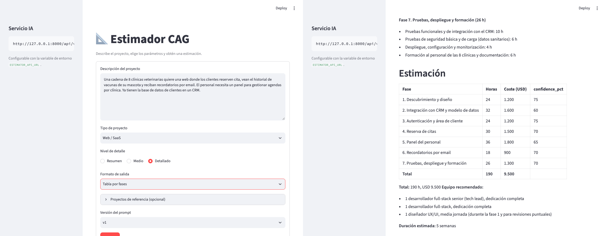
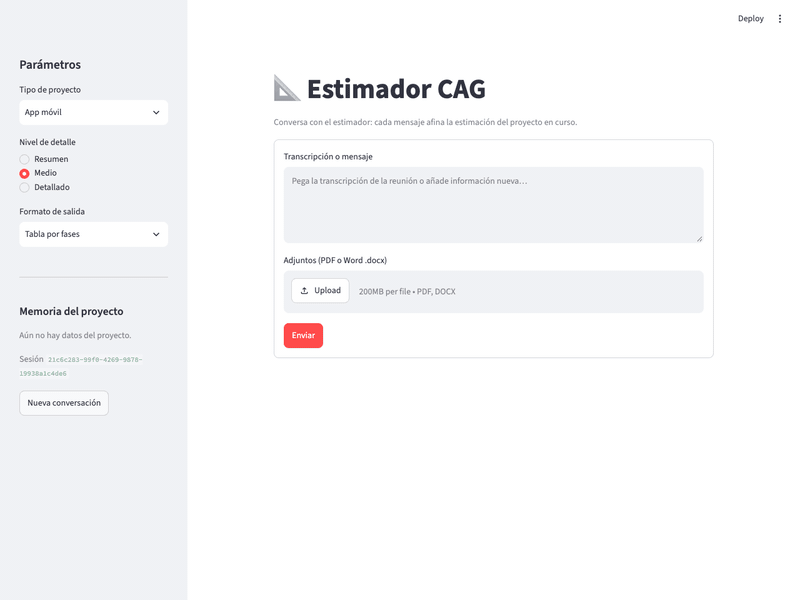

# Estimador CAG

Servicio IA (FastAPI) y cliente web (Streamlit) para generar estimaciones de
esfuerzo y recursos de proyectos de software. El usuario rellena un formulario
tipado (descripción, tipo de proyecto, nivel de detalle y formato de salida) y
el servicio construye el prompt a partir de templates Jinja2 versionados.



<details>
<summary>Demo animada</summary>



</details>

## Requisitos

- Python 3.11 o superior.
- [`uv`](https://docs.astral.sh/uv/getting-started/installation/).
- Una clave de API de OpenAI o Anthropic.

## Instalación y configuración

Desde este directorio (`estimador-cag`), instala las dependencias del proyecto
y las herramientas de prueba con `uv`:

```bash
uv sync --group dev
```

Copia `.env.example` a `.env` y configura el proveedor, su clave y un nombre de
modelo compatible:

```dotenv
LLM_PROVIDER=openai
LLM_MODEL=gpt-4o-mini
OPENAI_API_KEY=tu-clave-de-openai
```

Para usar Anthropic, configura `LLM_PROVIDER=anthropic`, indica un modelo de
Anthropic en `LLM_MODEL` (por ejemplo `claude-haiku-4-5-20251001`) y
proporciona `ANTHROPIC_API_KEY`. Solo se necesita la clave del proveedor
seleccionado, y solo la usa el servicio: el cliente no la ve nunca.

## Cómo se levanta

Son dos procesos. En una terminal, el servicio IA:

```bash
uv run uvicorn app.main:app --reload
```

La API queda en `http://127.0.0.1:8000` y su documentación OpenAPI en
`http://127.0.0.1:8000/docs`.

En otra terminal, el cliente Streamlit:

```bash
uv run streamlit run streamlit_app.py
```

Se abre en `http://localhost:8501`. Si el servicio está en otra dirección,
indícala con `ESTIMATOR_API_URL`:

```bash
ESTIMATOR_API_URL=http://mi-servidor:8000 uv run streamlit run streamlit_app.py
```

## Endpoints

### `GET /health`

Comprueba que la API está en ejecución:

```json
{"status": "ok"}
```

### `POST /api/v1/estimate`

Recibe un `EstimationRequest` (definido en [`app/schemas.py`](app/schemas.py)):

| Campo           | Valores                                                        |
| --------------- | -------------------------------------------------------------- |
| `description`   | Texto de 20 a 2000 caracteres (sin contar espacios de los extremos) |
| `project_type`  | `mobile_app`, `web_saas`, `internal_tool`, `data_pipeline`     |
| `detail_level`  | `summary`, `medium`, `detailed`                                |
| `output_format` | `phases_table`, `line_items`, `narrative`                      |
| `reference_projects` | Opcional. Hasta 5 proyectos `{name, summary, actual_hours}` ya entregados |

El query param opcional `prompt_version` elige la versión del prompt (`v1` por
defecto, o `v2`): `POST /api/v1/estimate?prompt_version=v2`.

```bash
curl -X POST http://127.0.0.1:8000/api/v1/estimate \
  -H "Content-Type: application/json" \
  -d '{
        "description": "Landing page con formulario de contacto, integración con HubSpot y un blog con editor WYSIWYG.",
        "project_type": "web_saas",
        "detail_level": "medium",
        "output_format": "phases_table"
      }'
```

Devuelve un `EstimationResponse` con el texto generado y la versión del prompt:

```json
{
  "text": "| Fase | Horas | Coste (USD) | confidence_pct | ...",
  "prompt_version": "v1"
}
```

Respuestas de error: `422` si el body no cumple el schema o la versión de prompt
no existe, y `503` si el proveedor no está configurado (por ejemplo, falta la
API key).

## Prompts versionados

Los prompts viven fuera del código, en
[`app/prompts/estimation/`](app/prompts/estimation/), con una carpeta por
versión:

```
app/prompts/
├── loader.py
└── estimation/
    ├── v1/
    │   ├── system.j2     # rol, instrucciones, bloques según output_format y detail_level
    │   ├── user.j2       # descripción en <project_description> y proyectos de referencia
    │   └── examples.j2   # ejemplos few-shot, incluido desde system.j2
    └── v2/               # mismo contrato, tono para un cliente no técnico y otros ejemplos
```

`render_estimation_prompt(request, version="v1")` en
[`app/prompts/loader.py`](app/prompts/loader.py) devuelve `(system, user)`, que
se envían al modelo como mensajes `system` y `user` separados. El entorno Jinja2
usa `StrictUndefined`, así que una variable que falte en el contexto rompe el
render en lugar de dejar un hueco silencioso. Cada versión tiene su propio
loader, de modo que un `` nunca mezcla ficheros de dos versiones.

Para cambiar un prompt ya publicado, crea una carpeta nueva (`v2/`) en lugar de
editar `v1/`: así cada respuesta puede atribuirse a la versión exacta que la
generó (`prompt_version`). Los costes de los ejemplos usan una tarifa ficticia
de USD 50 por hora; no representan precios comerciales.

Si la petición trae `reference_projects`, `user.j2` los recorre con un
`` dentro de un bloque `<reference_projects>` para que el modelo
calibre la estimación con horas reales. En el formulario se rellenan en la
tabla "Proyectos de referencia (opcional)".

Cada render emite un evento `prompt_rendered` con structlog que incluye la
versión y un hash del prompt renderizado (nunca la descripción, que puede
contener datos del cliente):

```
[info] prompt_rendered prompt_hash=5b007ed3c39065b3 prompt_name=estimation prompt_version=v1 ...
```

Dos peticiones con el mismo hash recibieron exactamente el mismo prompt.

## Pruebas

Ejecuta las pruebas localmente, sin llamar a OpenAI ni a Anthropic:

```bash
uv run pytest
```

- `tests/prompts/test_estimation_v1.py`: tests del template (milisegundos, sin
  red). Comprueban el bloque `<project_description>`, las instrucciones de cada
  `output_format` y `detail_level`, y que una versión desconocida se rechaza.
- `tests/prompts/test_estimation_versions.py`: que `v1` y `v2` cumplen el mismo
  contrato, los proyectos de referencia y el evento de log.
- `tests/test_api.py`: contrato del endpoint con un proveedor falso.
- `tests/test_streamlit_app.py`: el formulario con `AppTest` y el HTTP simulado.
- `tests/test_streaming.py`: streaming de los proveedores con el SDK simulado.

GitHub Actions ejecuta estas pruebas automáticamente en cada push y pull
request.
